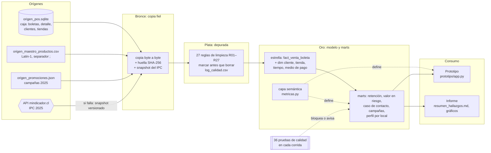
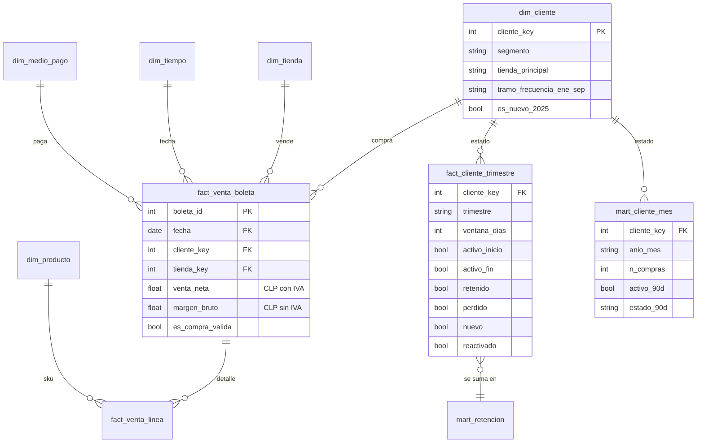
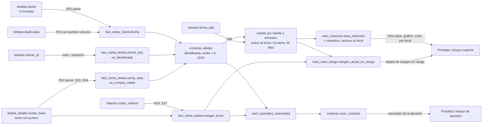

# Arquitectura de la cadena de datos (Entrega 2, componente B)

Este documento es la base de la sección B del informe y de la única lámina técnica de la Presentación 2.
Todo lo que dice se puede comprobar en el código (`cadena_datos/`) y en las salidas de la última corrida (`datos/oro/`).

## 1. Capas: qué pasa en cada una y por qué

| Capa | Carpeta | Qué transforma | Por qué la transformación vive aquí |
|---|---|---|---|
| Bronce | `datos/bronce/` | Nada. Copia las 3 fuentes y guarda la respuesta de la API, con su huella SHA-256 | Si una regla de limpieza está mal, se corrige y se vuelve a correr sin pedir de nuevo los datos. La huella prueba que el origen no cambió |
| Plata | `datos/plata/` | Formatos (4 formatos de fecha, montos como texto, 7 notaciones de descuento), duplicados exactos, categorías (24 grafías a 8), región de La Florida, campaña de cada línea | Son reglas de *calidad de la fuente*, independientes de la pregunta. Otra pregunta de negocio reusaría esta capa tal cual |
| Oro | `datos/oro/` | Modelo estrella, margen bruto, estado de cada cliente por trimestre, marts de la métrica y del caso de negocio | Son reglas de *negocio* (qué es una compra válida, un cliente activo, un cliente nuevo). Cambian si cambia la pregunta |
| Capa semántica | `cadena_datos/metricas.py` | Nombre, fórmula, unidad y regla de lectura de cada métrica; cálculo del caso de contacto | La métrica se escribe una vez. El informe y el prototipo la leen de aquí: mismo nombre, misma fórmula, mismo número |
| Consumo | `prototipo/app.py`, `datos/oro/resumen_hallazgos.md` | Nada. Solo lee oro y la capa semántica | Si el prototipo calculara algo propio, podría mostrar un número distinto al del informe |

Bronce y plata contienen RUT y nombres: no se suben al repositorio (Ley 21.719, minimización) y se regeneran en cada corrida. Oro no tiene identificadores directos (pruebas V17 y V17b).

## 1b. Modelo dimensional (corregido con el feedback de la E1)

El feedback de la E1 pidió que el diagrama muestre la tabla donde se calcula la retención. Ahora hay dos hechos a dos granos, más la tabla cliente-mes:

| Tabla | Grano: "una fila es…" | Para qué |
|---|---|---|
| `fact_venta_boleta` | una boleta única | Ventas, margen y qué compras cuentan para la retención |
| `fact_cliente_trimestre` | un cliente en un trimestre bajo una ventana (snapshot periódico) | **Aquí se calcula la retención**: activo al inicio, activo al cierre, retenido, perdido, nuevo, reactivado |
| `mart_cliente_mes` | un cliente en un mes | Estado mensual de cada cliente (recurrente, nuevo, reactivado, inactivo) |
| `mart_retencion` | corte × valor × período × ventana | Suma de `fact_cliente_trimestre` por corte; la prueba M05 verifica que cuadra |

## 2. Tres decisiones defendidas

### ETL, no ELT
Transformamos en Python antes de cargar (ETL) y no en una base de datos después de cargar (ELT).
- **Por qué:** el volumen es chico (6.251 boletas, 14.344 líneas) y las fuentes vienen en tres formatos que una base de datos no lee directo (CSV en Latin-1 con separador `;`, JSON anidado, API). Pandas resuelve los tres en el mismo lenguaje en que están las pruebas.
- **Qué perderíamos:** con ELT, cualquier analista podría consultar la capa cruda con SQL. Lo compensamos dejando bronce como copia fiel y plata en CSV: la capa cruda existe igual.
- **Cuándo cambiaría:** si la empresa entrega las boletas de todas sus tiendas a diario (millones de filas), conviene cargar a un almacén y transformar en SQL.

### Carga completa e idempotente, no incremental
Cada corrida reescribe bronce, plata y oro desde el origen.
- **Por qué:** la retención de un trimestre depende de las compras de los 90 días anteriores, y la definición de cliente nuevo depende de toda la historia del cliente. Una carga incremental tendría que recalcular igual esas ventanas. Con este volumen, la carga completa demora menos de 30 segundos.
- **Cómo no duplica ni pierde:** las 61 boletas idénticas se cuentan una vez (regla R01) y la prueba M02 verifica en cada corrida que el hecho tiene exactamente las boletas de plata. Correr dos veces seguidas da los mismos archivos (lo comprobamos en un ambiente limpio).
- **Cuándo cambiaría:** con varios años de historia, se cargaría solo el mes nuevo a bronce y se recalcularían los marts de los últimos 180 días.

### Falla de una fuente
| Fuente | Si falla | Cómo se avisa | Qué muestra el prototipo |
|---|---|---|---|
| API del IPC | Se usa el último snapshot bueno, versionado en `cadena_datos/referencias/ipc_2025_snapshot.json` | Prueba F05 en amarillo (avisa, no bloquea); `estado_fuentes.csv` queda en `respaldo`; la salida de la consola lo dice | Un aviso arriba de la pantalla: "la API no respondió, se usó el último dato bueno". La retención y el margen no cambian: el IPC solo afecta la venta deflactada |
| SQLite, CSV o JSON | La corrida no se publica (pruebas F01 a F03 bloquean) | Código de salida 1, el nombre de la prueba en la consola y la corrida registrada con `publicada = False` en `historial_corridas.csv` | Sigue mostrando la última corrida buena, con un aviso rojo arriba que dice qué corrida falló, qué pruebas y desde qué fecha son los datos que se ven |

La API también puede responder con datos malos. Por eso, antes de aceptar la respuesta, la cadena exige la serie completa de los 12 meses de 2025 con valores numéricos; si no la trae, se trata igual que una caída y se usa el respaldo.

Para mostrarlo en vivo: `python cadena_datos/run_pipeline.py --simular-falla-api` (API caída, se usa el respaldo y se publica con aviso) y `python cadena_datos/run_pipeline.py --simular-falla-calidad` (se duplica una boleta en el hecho, las pruebas M01, M02 y V14 bloquean y oro no se toca).

## 3. Pruebas de calidad (36, todas corren en cada ejecución)

Resultado de la última corrida: **36 de 36 en verde** (`datos/oro/validaciones.csv`).

- **Bloquea:** si falla, la capa oro **no se publica**. La cadena arma oro en memoria, corre las pruebas y solo si todas las que bloquean pasan escribe `datos/oro/`, los gráficos y la documentación. Si no, deja las pruebas fallidas en `datos/cuarentena/` y el tablero sigue con la última corrida buena.
- **Avisa:** se publica, con el aviso a la vista en el prototipo.
- **Cada resultado se guarda en una tabla**, no solo en la consola: corrida, qué verifica, si pasó, cuántas filas fallaron (`filas_fallidas`) y qué acción corresponde. La última corrida está en `validaciones.csv` y todas las corridas se acumulan en `historial_pruebas.csv`.

| Grupo | Pruebas | Qué protegen | Si fallan |
|---|---|---|---|
| Una por fuente | F01 SQLite (7 tablas y boletas), F02 CSV (columnas requeridas), F03 JSON (fechas de campañas en 2025), F04 API (12 meses con valores en rango), F05 API respondió | Que la fuente llegó completa y con la forma esperada | F01–F04 bloquean; F05 avisa |
| Integridad bronce → plata → oro | V01–V22 (23 pruebas de la E1) | Que no se pierde ni se duplica nada, que los montos cuadran, llaves sin huérfanos, sin RUT en oro | Bloquean, salvo V07, V10, V16 y V20 que avisan |
| Protegen la métrica | M01 clave del hecho única · M02 recarga sin duplicar · M03 fechas dentro de 2025 · M04 tasas entre 0 y 1 · M05 la cifra oficial coincide con un recálculo directo · M06 margen en rango · M07 cobertura de costo ≥ 95% · M08 completitud del acuerdo de servicio | Que el 51,1% y el margen en riesgo son reproducibles y están en rango | M01–M06 bloquean; M07 y M08 avisan |

Las pruebas unitarias de la lógica (71, en `cadena_datos/tests/`) prueban casos sintéticos de resultado conocido: bordes de la ventana, estados de un cliente, intervalo de Wilson, margen e imputación, y el caso de contacto.

## 4. Linaje de la métrica

| Campo que entra en la métrica | Fuente | Transformación | Pantalla que lo consume |
|---|---|---|---|
| `fecha` | SQLite `boletas.fecha` | R02: 4 formatos a fecha; R03: fuera de 2025 con marca (S01) | Filtro de trimestre; todas las tasas |
| `cliente_key`, `es_identificada` | SQLite `boletas.cliente_id` | Nulo = anónimo (−1), fuera de la retención (S12) | Cobertura (tarjeta "Cobertura del análisis") |
| `venta_neta`, `es_compra_valida` | SQLite `boleta_detalle.monto_linea` | R10: texto a número; suma por boleta; devoluciones restan (S04); válida si > 0 | Define quién está activo |
| `margen_bruto` | CSV `costo_unitario` + SQLite `monto_linea` | venta / 1,19 − unidades × costo; costo faltante imputado (S17) | Margen en riesgo y simulador |
| `es_nuevo_2025` | SQLite `clientes.fecha_alta` | Alta en 2025 (S06) | Índice de reposición |
| `tienda_principal` | SQLite `boletas.tienda_id` | Local con más compras del cliente (S09) | Corte por local |
| `ipc_indice` | API mindicador.cl | Variación mensual encadenada, base dic-2024 (S16, S21) | Solo venta real (no entra en la métrica) |

## 5. Acuerdo de servicio de `mart_retencion` (tabla principal)

| Compromiso | Valor | Cómo se mide |
|---|---|---|
| Frescura | Mensual: la cadena corre el día hábil 3 de cada mes con el cierre del mes anterior | Fecha de la última corrida en `historial_corridas.csv` y en el pie del prototipo |
| Completitud | Cada mes con al menos 80% de las boletas con tarjeta (2025: 86,9% en el año) | Prueba M08 |
| Calidad | 100% de las pruebas que bloquean en verde para publicar | Columna `fallas_que_bloquean` de `historial_corridas.csv` |
| Dueño de la métrica | Subgerente de Clientes y Fidelización (Gerencia Comercial) | Decide la ventana oficial y aprueba cambios de definición |
| Dueño del dato | Jefe de BI | Corre la cadena, revisa las pruebas y responde si una falla |

Los cargos son una propuesta del grupo: hay que confirmarlos con la contraparte (ver `Entrega2.md`, pendientes).
